# Nutztierkosmos – Grobkonzept und Click-Dummy

**Webbasierte Informations- und Wissensplattform mit Gamification-Elementen** für das
Forschungsinstitut für Nutztierbiologie (FBN), Dummerstorf.

**▶ Demo ansehen: <https://mtothexmax.github.io/nutztierkosmos/>**

> [!NOTE]
> **Dies ist eine Demo (Click-Dummy) für das Verhandlungsverfahren.** Sie zeigt Aufbau, Bedienung
> und Funktionsumfang, ist aber kein Produktivsystem:
> - Alle Publikationen, Personen und Zahlen sind **Platzhalter**, keine echten FBN-Veröffentlichungen.
>   Die Fotos sind KI-generiert.
> - Es gibt **kein Backend**. Inhalte und Änderungen liegen nur im Browser (`localStorage`, IndexedDB)
>   und lassen sich unter *Redaktion → Einstellungen* zurücksetzen.
> - Die Anmeldung zur Redaktion ist **simuliert** (Demo-Konten, Passwort `demo`).
> - Die Demo läuft auf GitHub Pages. **Für den Betrieb ist Hosting beim deutschen Anbieter
>   [Hetzner](https://www.hetzner.com/) geplant** – der Plan dafür steht unten unter
>   [Hosting bei Hetzner](#7-hosting-bei-hetzner).

Grundlage ist die Leistungsbeschreibung des FBN samt Antworten auf die Bieterfragen. Wie jede
Anforderung in der Demo umgesetzt ist, steht in [`konzept/ANFORDERUNGEN.md`](konzept/ANFORDERUNGEN.md).
In der Demo zeigt außerdem ein Button unten rechts („N Anforderungen“), welche Anforderungen der
gerade sichtbare Screen abdeckt.

## Inhalt

1. [Ausgangslage und Ziel](#1-ausgangslage-und-ziel)
2. [Zielgruppen](#2-zielgruppen)
3. [Informationsarchitektur](#3-informationsarchitektur)
4. [Funktionen](#4-funktionen)
5. [Barrierefreiheit und Datenschutz](#5-barrierefreiheit-und-datenschutz)
6. [Technische Architektur](#6-technische-architektur)
7. [Hosting bei Hetzner](#7-hosting-bei-hetzner)
8. [Vorgehen und Vertrag](#8-vorgehen-und-vertrag)
9. [Im Feinkonzept zu klären](#9-im-feinkonzept-zu-klären)
10. [Rundgang durch die Demo](#10-rundgang-durch-die-demo)
11. [Entwicklung](#11-entwicklung)

---

## 1. Ausgangslage und Ziel

Das FBN forscht zu Nutztieren – zu Haltung, Gesundheit, Verhalten, Fütterung und Umweltwirkung.
Viele Ergebnisse erscheinen in Fachpublikationen, die für die breite Öffentlichkeit schwer
zugänglich sind. Nutztierkosmos übersetzt sie in **kurze, verständliche Ausstellungen** mit Bild,
Video, Grafiken und kleinen Mitmach-Angeboten.

Ziele:

- **Verständlich:** Jede Ausstellung fasst eine FBN-Publikation prägnant zusammen – in einfacher
  Sprache, mit Kernaussagen, Medien und Quellenangabe.
- **Auffindbar:** Klare Gliederung nach Tierart und Thema, Volltextsuche mit Filtern.
- **Zum Mitmachen einladend, aber freiwillig:** Quizze und Spiele vertiefen das Wissen. Alle Inhalte
  bleiben ohne Gamification, Anmeldung oder Namen vollständig erreichbar (LB 5.5).
- **Ohne Programmierkenntnisse pflegbar:** Die Redaktion legt Ausstellungen, Medien, Quizze und
  interaktive Grafiken selbst an, mit Freigabe-Workflow und Versionen.
- **Barrierefrei und datensparsam** von Anfang an (LB 8, 9.2).

## 2. Zielgruppen

| Zielgruppe | Was sie braucht | Einstieg in der Demo |
|---|---|---|
| Interessierte Öffentlichkeit | Schnelle, verständliche Antworten | Startseite, Suche, Themen |
| Schulen | Ausstellungen mit Quiz für den Unterricht | Zielgruppen-Einstieg „Schule“, Mitmachen |
| Studium und Wissenschaft | Publikationen, Quellenangaben | Publikationsblock jeder Ausstellung |
| Presse | Faktenblätter, Medien, Ansprechpersonen | Zielgruppen-Einstieg „Presse“, PDF-Downloads |
| Redaktion des FBN | Einfache Pflege, Prüfung, Übersicht | `/admin` mit vier Rollen |

## 3. Informationsarchitektur

```
Kategorie (Tierart)          z. B. Rind, Schwein, Geflügel
└── Thema (Schwerpunkt)       z. B. Hitzestress bei Rindern
    └── Ausstellung           z. B. „Wenn es der Kuh zu heiß wird“
        ├── Bausteine         Text, Kernaussagen, Medium, Galerie, Infografik, Quiz, Spiel
        ├── Publikationen     FBN-Veröffentlichungen als Grundlage, mit Quellenangabe
        └── Schlagwörter, Zielgruppen, Sprache (DE/EN)
```

- **Kategorien** entsprechen Tierarten; sie sind der wichtigste Einstieg und gliedern auch die
  Mitmach-Angebote.
- **Themen** bündeln Ausstellungen und haben ein Themengebiet (z. B. Tierwohl, Klima), nach dem die
  Suche filtert.
- **Ausstellungen** bestehen aus frei anordenbaren Bausteinen. Quizze und Spiele sind gleichrangige
  „Mitmach-Angebote“ – maßgeblich für ihre Einordnung ist das Thema, nicht die Art.
- **Zweisprachig:** Alle pflegbaren Texte haben eine deutsche (Pflicht) und eine englische Fassung.
  Auch Quizze und Spiele werden nur einmal angelegt; im Editor schaltet die Redaktion zwischen Deutsch
  und Englisch um. HTML-Spiele erhalten die Sprache per `postMessage` (`INIT.payload.locale`).
  Fehlt die Übersetzung, erscheint der deutsche Text mit Hinweis.

Das vollständige Datenmodell steht in [`src/lib/types.ts`](src/lib/types.ts).

## 4. Funktionen

### Öffentliche Website

- Startseite mit Suche, Einstieg nach Tierart, neuen Ausstellungen und Zielgruppen-Einstiegen
- Themen- und Ausstellungsseiten mit Breadcrumbs, Inhaltsverzeichnis, Lesezeit, Schlagwörtern
- **Medien:** Bilder mit Alternativtext, Video mit Untertiteln (DE/EN, WebVTT) und Transkript, Audio
  mit Transkript, Galerie, PDF-Download
- **Interaktive Infografiken:** individuell programmierter THI-Rechner (Hitzestress) sowie Balken- und
  Hotspot-Grafiken, die die Redaktion selbst pflegt
- **Suche:** Volltext mit Relevanz (Titel vor Schlagwort vor Kurztext vor Volltext), Filter nach
  Tierart, Themengebiet, Inhaltstyp, Schlagwort, Zielgruppe; Zustand in der URL (teilbar)
- **Sprachwahl DE/EN** im Kopf, Gestaltung angelehnt an den Webauftritt des FBN

### Mitmachen (freiwillig)

- **Quiz** mit vier Fragetypen: Multiple Choice (auch Mehrfachauswahl), Richtig/Falsch, Bilderrätsel
  (Auswahl oder Klick ins Bild) und Zuordnung (Antippen oder Ziehen, auch Mehrfachverbindungen).
  Sofortige Rückmeldung mit Erklärung; angekreuzte und richtige Antworten sind auch in Worten
  gekennzeichnet, nicht nur über Farbe.
- **HTML-Spiele** als ZIP-Paket, isoliert im iframe, mit dokumentierter `postMessage`-API und
  Einstellungsdatei `game.json` ([`konzept/GAME-API.md`](konzept/GAME-API.md)). Beispiel: das
  3D-Lernspiel „Ein heißer Tag auf der Weide“.
- **Forscherpass:** anonym, nur nach Zustimmung, nur auf dem eigenen Gerät; Abzeichen für gelesene
  Ausstellungen und abgeschlossene Quizze/Spiele.

### Redaktion

| Rolle | Darf |
|---|---|
| Redaktion | Inhalte anlegen und bearbeiten, Medien pflegen, Ausstellungen zur Prüfung einreichen |
| Fachprüfung | Ausstellungen prüfen, freigeben oder mit Kommentar zurückgeben |
| Administration | Alles, zusätzlich Benutzer, Einstellungen und Sicherheitsprotokoll |
| Auswertung | Nur Übersicht und Nutzungsstatistik |

- **Freigabe-Workflow:** Entwurf → In Prüfung → Veröffentlicht (→ Archiviert), mit Prüfliste
  (z. B. „mindestens eine Publikation verknüpft“, „Alternativtext vorhanden“)
- **Versionen** bei jedem Speichern, **Vorschau** unveröffentlichter Ausstellungen
- **Medienbibliothek**, Publikationen, Schlagwortkatalog, Struktur (Kategorien/Themen)
- **Quiz- und Spiele-Editor** ohne Code; ZIP-Upload übernimmt die Einstellungen aus `game.json`
- **Texte und Übersetzungen** der Oberfläche, **Statistik** (datensparsam), **Protokoll**
  sicherheitsrelevanter Ereignisse (Anmeldung, Rechte, Veröffentlichung, verweigerte Zugriffe)

## 5. Barrierefreiheit und Datenschutz

**Barrierefreiheit** (Ziel: WCAG 2.1 AA bzw. BITV 2.0; laut Bieterfragen genügt eine interne
Prüfung durch den Auftragnehmer):

- Bedienbar per Tastatur, sichtbarer Fokus, Sprunglink zum Inhalt, sinnvolle Überschriftenstruktur
- Beschriftete Formularfelder, `aria`-Zustände bei Auswahl, Ergebnisse auch in Worten
- Alternativtexte, Untertitel und Transkripte; `lang`-Attribut bei nicht übersetzten Texten
- `prefers-reduced-motion` wird beachtet; Layout bis 360 px Breite ohne seitliches Scrollen
- Geplant: Prüfprotokoll mit axe/Lighthouse und manuellem Screenreader-Test (NVDA, VoiceOver)

**Datenschutz** (Privacy by Design, LB 9.2):

- **Keine Abrufe bei Dritten:** Schriften (Open Sans), Icons und Medien werden selbst ausgeliefert.
- **Keine Pflicht-Anmeldung, keine Namen** für Besucherinnen und Besucher.
- **Statistik ohne Cookies:** im Betrieb Matomo, selbst gehostet, cookielos, IP-Adressen gekürzt –
  damit ist kein Einwilligungsbanner nötig.
- Forscherpass nur lokal auf dem Gerät, jederzeit löschbar.
- Hosting ausschließlich in Rechenzentren in Deutschland, mit Auftragsverarbeitungsvertrag (AVV).

## 6. Technische Architektur

### Heute: die Demo



- **SvelteKit 3, Svelte 5, Tailwind CSS 4, TypeScript.** Die App rendert vollständig im Browser.
- Die Speicherschicht ist gekapselt ([`src/lib/storage/db.ts`](src/lib/storage/db.ts),
  [`files-db.ts`](src/lib/storage/files-db.ts)) und kann gegen eine API getauscht werden, ohne die
  Oberfläche umzubauen.
- `export.ps1` baut eine statische Fassung nach `docs/`, die GitHub Pages ausliefert.

### Geplant: Betrieb



| Baustein | Technik | Aufgabe |
|---|---|---|
| Web-App | SvelteKit (Node.js, serverseitiges Rendern) | Website und Redaktionsoberfläche aus dieser Demo; SSR für Suchmaschinen und schnellen ersten Seitenaufbau |
| API | ASP.NET Core + Entity Framework Core | Inhalte, Freigabe-Workflow, Versionen, Rollen und Rechte, Protokoll, Statistik-Zähler |
| Datenbank | PostgreSQL | Inhalte, Versionen, Benutzer, Protokoll |
| Dateien | S3-kompatibler Object Storage | Medien, PDFs, Spiel-ZIPs; Auslieferung über signierte URLs |
| Statistik | Matomo, selbst gehostet | cookielose Nutzungsstatistik |
| Reverse Proxy | Caddy | HTTPS mit automatischen Zertifikaten, Kompression, Sicherheits-Header |
| Anmeldung | Konten mit Passwort und Zwei-Faktor-Authentisierung; optional Anbindung an das Verzeichnis des FBN (z. B. Entra ID / LDAP) | Redaktion |

Die Demo dient dabei unmittelbar als Ausgangspunkt: Oberfläche, Datenmodell und Spiel-API bleiben,
die Browser-Speicherschicht wird durch Aufrufe der API ersetzt.

## 7. Hosting bei Hetzner

Geplant ist der Betrieb bei **Hetzner Online GmbH** in einem deutschen Rechenzentrum
(Nürnberg oder Falkenstein). Hetzner bietet einen Auftragsverarbeitungsvertrag nach Art. 28 DSGVO an.

### Komponenten

| Komponente | Hetzner-Produkt | Größe (Vorschlag) | Zweck |
|---|---|---|---|
| Produktivserver | Cloud Server CX32 | 4 vCPU, 8 GB RAM, 80 GB SSD | Docker Compose: Caddy, Web-App, API, PostgreSQL, Matomo |
| Staging-Server | Cloud Server CX22 | 2 vCPU, 4 GB RAM | Abnahme, Schulung, Test neuer Versionen |
| Dateien | Object Storage | nach Bedarf, Start < 100 GB | Medien, PDFs, Spiel-ZIPs |
| Backups | Server-Backups + Storage Box BX11 | 1 TB | tägliche Snapshots, nächtliche Datenbank-Dumps |
| Netzwerk | Cloud Firewall, Primary IPv4/IPv6 | – | nur Port 80/443 offen, SSH nur aus dem Admin-Netz |

Der Produktivserver ist für die erwartete Nutzung großzügig bemessen und lässt sich bei Hetzner in
wenigen Minuten vergrößern. Bei hoher Last kann die Web-App auf einen zweiten Server mit Load
Balancer verteilt werden; die Datenbank bleibt zunächst auf einem Server.

### Laufende Kosten (Richtwert)

Größenordnung **etwa 25–35 € netto im Monat** für Produktiv- und Staging-Server, Backups, Object
Storage, Storage Box und IP-Adressen. Hinzu kommt die Domain, falls sie nicht über das FBN läuft.

> [!IMPORTANT]
> Die Beträge sind Richtwerte und vor Angebotsabgabe anhand der aktuellen Hetzner-Preisliste zu
> prüfen. Laut Bieterfragen sind Domain und Hosting vollständig in die Gesamtkosten einzurechnen.

### Sicherheit und Betrieb

- **Härtung:** nur SSH-Schlüssel, kein Root-Login, automatische Sicherheitsupdates
  (`unattended-upgrades`), fail2ban; Container laufen ohne Root-Rechte.
- **HTTPS überall:** Caddy holt und erneuert die Zertifikate automatisch; HSTS und strenge
  Content-Security-Policy.
- **Backups:** tägliche Server-Snapshots (7 Tage) und nächtlicher `pg_dump` in die Storage Box
  (30 Tage), Object Storage mit Versionierung. **Wiederherstellung wird vierteljährlich geprobt.**
- **Überwachung:** Uptime-Monitoring der öffentlichen Seiten und der API, Benachrichtigung per E-Mail;
  Logs bleiben auf dem Server, Aufbewahrungsfristen laut Feinkonzept.
- **Auslieferung:** Jede Änderung durchläuft eine CI-Pipeline (Typprüfung, Tests, Build) und landet als
  Container-Image zuerst auf Staging, nach Freigabe auf Produktion – per `docker compose pull`,
  mit Rückkehr zur vorherigen Version in einem Schritt.
- **Lasttest vor Abnahme** (z. B. mit k6) gegen die im Feinkonzept festgelegten Zielwerte.

### Inbetriebnahme in Schritten

1. Projekt bei Hetzner anlegen, AVV abschließen, Server, Firewall, Object Storage und Storage Box einrichten
2. Domain bzw. Subdomain des FBN auf den Server zeigen lassen (DNS beim FBN)
3. Docker Compose mit Caddy, Web-App, API, PostgreSQL und Matomo ausrollen – zuerst auf Staging
4. Backups und Monitoring einschalten, Wiederherstellung einmal vollständig testen
5. Lasttest und Barrierefreiheitsprüfung auf Staging, Abnahme durch das FBN
6. Erstbefüllung durch das FBN (laut Bieterfragen ca. 100 Publikationen zum Start), dann Freischaltung

## 8. Vorgehen und Vertrag

**Vorgehen** (Vorschlag):

1. **Feinkonzept** auf Basis dieses Grobkonzepts und der Demo – inklusive der offenen Punkte unten
2. **Umsetzung** in kurzen Iterationen mit regelmäßigen Vorführungen auf Staging
3. **Erstbefüllung** durch das FBN, Schulung der Redaktion
4. **Abnahme** (Funktionen, Barrierefreiheit, Last, Sicherheit) und **Inbetriebnahme**
5. **Betrieb, Wartung und Support** optional, mit vorher festgelegten Servicezeiten und Reaktionszielen

**Vertrag:** Grundlage ist der **EVB-IT Erstellungsvertrag** (in den Bieterfragen bestätigt:
„Es ist der EVB-IT Erstellungsvertrag gemeint“) sowie eine **Auftragsverarbeitungsvereinbarung**.
Der eigene Vertragsentwurf auf Basis des Musters gehört laut Bieterfragen zum Erstangebot.

## 9. Im Feinkonzept zu klären

Die Leistungsbeschreibung nennt in Anlage A Punkte, die vor Zuschlag oder im Feinkonzept festgelegt
werden. Die Demo enthält dafür jeweils einen Vorschlag:

| Punkt | Vorschlag |
|---|---|
| Betriebs- und Hostingmodell | Hetzner Cloud wie oben, Staging + Produktion |
| Erwartete Nutzung, Performance- und Lasttestwerte | Zielwerte gemeinsam festlegen, z. B. Antwortzeiten im 95. Perzentil unter 1 s bei definierter gleichzeitiger Nutzung |
| Gamification-Mechaniken und Auswertungen | Quiz-Typen, HTML-Spiele und anonymer Forscherpass wie in der Demo; Auswertung nur aggregiert |
| Umfang einer restriktiven Downloadbereitstellung | Download pro Medium schaltbar, global abschaltbar (in der Demo umgesetzt) |
| Übersetzungsworkflow Deutsch/Englisch | Englisch als eigene Fassung je Inhalt, Hinweis bei fehlender Übersetzung, Übersicht offener Übersetzungen |
| Aufbewahrungs- und Löschfristen | Protokoll und Statistik mit festen Fristen, automatische Löschung |
| Wartung und Support | Laufzeit, Servicezeiten, Reaktions- und Wiederherstellungsziele vor Beauftragung festlegen |

## 10. Rundgang durch die Demo

1. **Startseite** – Suche, Einstieg nach Tierart, neue Ausstellungen, Einstiege für Zielgruppen.
2. **Beispiel-Ausstellung** „Wenn es der Kuh zu heiß wird“ – alle Medienformate: Kernaussagen, Text,
   THI-Rechner, Video mit Untertiteln DE/EN, Hotspot-Grafik, Galerie, Audio mit Transkript, PDF,
   Quiz, 3D-Spiel, Publikationen mit Quellenangabe.
3. **Sprachumschalter** oben rechts – fehlt eine Übersetzung, erscheint ein Hinweis
   (z. B. bei „Methan aus dem Pansen“).
4. **Suche** – Volltext, Filter, Sortierung.
5. **Quizze** „Hitzestress-Check“ (alle Fragetypen), „Was sagt mir das Schwein?“ (Bildfragen),
   „Was brauchen Hühner?“ (Zuordnung).
6. **Mitmachen** – Quizze und Spiele nach Tierart, freiwilliger Forscherpass.
7. **Redaktion** `/admin` – Demo-Konten auf der Anmeldeseite, Passwort `demo`:
   - Tom Albers (Redaktion) reicht „Kalk für starke Schalen“ zur Prüfung ein,
   - Dr. Lea Hoffmann (Fachprüfung) gibt frei → die Ausstellung ist öffentlich,
   - Jana Krüger (Administration) sieht Benutzer, Protokoll und Einstellungen,
   - Sven Ruhl (Auswertung) sieht nur Übersicht und Statistik.

**Zurücksetzen:** *Redaktion → Einstellungen → Demo-Daten zurücksetzen*.

## 11. Entwicklung

```sh
npm install
npm run dev        # Entwicklungsserver, http://localhost:5173
npm run check      # Typprüfung
npm run build      # Produktions-Build
npm run games      # Spielpakete aus games/ prüfen und bereitstellen
npm run icons      # PNG-Icons aus static/logo.svg erzeugen
npm run diagrams   # Architekturskizzen aus konzept/architektur/*.mmd erzeugen
```

**Statischer Export für GitHub Pages** (Windows PowerShell):

```powershell
.\export.ps1                          # baut nach docs/, Unterpfad /nutztierkosmos
.\export.ps1 -BasePath "/anderer-pfad"
```

Danach `docs/` committen und pushen. In den Repository-Einstellungen muss GitHub Pages auf den
Ordner `/docs` des veröffentlichten Branches zeigen.

**Spielpakete:** ZIPs in `games/` mit `game.json` (oder einer gleichnamigen `.json` daneben). Beim
Build holt `scripts/sync-games.mjs` die neueste Version aus den in `package.json` unter
`nutztierkosmos.gameSources` eingetragenen Quellen. Details: [`konzept/GAME-API.md`](konzept/GAME-API.md).

**Logo und Icons:** Einzige Quelle ist `static/logo.svg`; die PNGs entstehen automatisch.

### Projektstruktur

```
src/lib/types.ts                 Datenmodell (Kategorie → Thema → Ausstellung, Quiz, Spiel, Medien …)
src/lib/stores/                  content (Inhalte, Suche, Workflow), session (Rollen), pass (Forscherpass)
src/lib/storage/                 localStorage und IndexedDB, Demo-Inhalte (seed.ts)
src/lib/games/                   Spielpakete: Regeln, ZIP-Verarbeitung, API-Doku und KI-Skill
src/lib/components/site/         öffentliche Komponenten (Header, Karten, Medien …)
src/lib/components/info/         interaktive Infografiken
src/lib/components/admin/        Redaktions-Komponenten
src/lib/paths.ts                 Unterpfad für den statischen Export
src/routes/                      Seiten (öffentlich, Quiz/Spiel, /admin)
static/                          Logo, Demo-Medien
games/                           Spiel-ZIPs mit Einstellungen
scripts/                         Build-Helfer: Icons, Spielpakete
konzept/                         Anforderungen, Spiel-API, Planung, Architekturskizzen
docs/                            statischer Export für GitHub Pages (erzeugt durch export.ps1)
export.ps1                       Export-Skript
```
